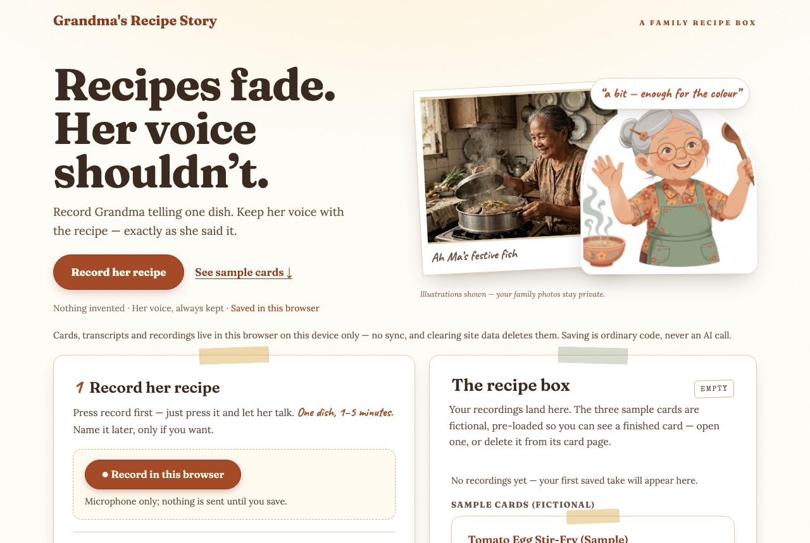

# Grandma's Recipe Story

> **Recipes fade. Her voice shouldn't.**
>
> Record Grandma telling one dish. Keep her voice with the recipe —
> exactly as she said it.



*The live landing page at https://grandma-recipe.danielquek.com (28 Oct 2026).
The old-photo and grandma character images are AI-generated illustrations;
your family photos and recordings stay private on your device.*

A mobile-friendly app for preserving a short cooking recording as an
editable recipe and family story, with original audio and visible uncertainty.

**Status (28 Oct 2026): Milestones A–E are code-complete — sample flow,
Spark extraction, Voice transcription, family evidence/print, and
browser recording. Wonder final review done (see [review](docs/REVIEW.md)).
The home opens on one light landing section (tagline, vintage photo,
animated grandma character), then the recorder: press **Record in this
browser** first — no name, dish, language or checkbox to fill in before
recording. Naming the card is optional and happens at save time (blanks
save as “Grandma · Untitled dish”); a WAV upload remains as fallback,
and the recipe box beside it is pre-loaded with three fictional sample
cards. Deployed at https://grandma-recipe.danielquek.com (container
v7, image `c2b68f9d…`). Checks: typecheck, lint (49 files) and 62 tests
passing. One live Spark extraction verified; live Voice transcription
not yet verified on a real recording. A three-minute demo video has
been rendered locally (git-ignored, not yet uploaded — see
[demo storyboard](docs/DEMO.md)).**

The implementation guide is
[Grandmas_Recipe_Story_Codex_Muse_Build_Guide.md](Grandmas_Recipe_Story_Codex_Muse_Build_Guide.md)
(now the Muse playbook; filename kept for link stability).
Start with [setup](docs/SETUP.md), [plan](docs/PLAN.md) and [handoff](docs/HANDOFF.md).

Development happens in **Muse**: Daniel starts each session from the
project folder with the model the task needs — Muse Spark 1.3 (medium) for
routine work, Muse Wonder 1.0 (high) for architecture and review — then
opens with "Read AGENTS.md and docs/HANDOFF.md" plus one bounded task. Model
switching means starting a new session. See [setup](docs/SETUP.md).

For the optional live API smoke (Daniel's terminal, hidden key prompt):

```zsh
cd /Users/danielquek/grandma-receipe-story
zsh scripts/with-meta-key.zsh node scripts/meta-smoke.mjs
```

The helper prompts for a Meta key without echoing or saving it. The smoke test
sends one short Spark request and, unless authentication fails, one synthetic
speech recording to Voice Transcribe. It records sanitized results in ignored
`data/setup/meta-smoke-results.json`. No family recording is required.

The older Codex profiles and `scripts/muse-codex.py` launcher (27 Oct 2026)
are legacy history — they worked around Meta's recursive tool-schema
rejection; see [the compatibility diagnosis](docs/SETUP.md#legacy-recursive-json-schema-error-codex-era-27-oct-2026).

The hackathon scope is **Indie developer track / Build for Your World**, a public
GitHub repository, and an accessible video of at most three minutes.
[Submission preparation](docs/SUBMISSION.md) and [demo storyboard](docs/DEMO.md)
remain drafts until the app works and evidence is captured. No form or legal
terms will be submitted or accepted by the agent.

A landing-page screenshot is included at the top of this README; licence
choice and a published demo-video link are still pending. Judges can run
the visibly labelled sample mode without credentials or Codex (see Milestone A
below).

---

## Milestone A app (sample mode, no key required)

Implemented 27 October 2026 (Spark session): start/consent, WAV upload with
byte-level validation, editable transcript with approval, fictional sample
draft with visible unknowns, at most three clarification answers, family
corrections, saved-card list/reopen/delete, private audio playback and a
print-friendly card. Saving is ordinary code, never a model call.

Run in your own terminal with network access (this sandbox has none):

```zsh
npm ci
cp .env.example .env   # defaults run sample mode; no keys needed
npm run dev            # http://localhost:3000
```

Checks (all passing in the implementation session):

```zsh
npm run typecheck
npm run lint           # offline project guard (privacy + grounding)
npm test               # node:test, 62 tests
npm run build
```

Notes and limits: `package-lock.json` is pinned; install with `npm ci`. A live
server could not bind a port in the sandbox, so the journey was verified at
the store/handler level plus `next build` static output instead of a browser
click-through. Mobile/print layout was verified by stylesheet and markup
inspection only. Private runtime data stays in `DATA_DIR` (`./data/app`,
ignored); only the fictional `samples/` ships.

---

## Milestone B: grounded extraction (Spark, explicit paid call)

Implemented 27 October 2026: approving a transcript unlocks one explicit
Spark extraction (`POST /api/recipes/:id/extract`). Output is constrained by
a flat non-recursive JSON Schema (`src/server/extraction-schema.ts`) and
re-validated in code (segment-ID membership, null-quantity confirmation,
verbatim quotes, ≤3 questions, measurements flagged). Cache key = canonical
input hash + model + prompt/schema versions; concurrent calls share one
request; refresh/save/print/reopen never call the model. Regeneration inserts
a new version and keeps prior versions plus manual corrections. Missing keys
and live failures surface as visible safe codes — never silent sample fallback.

Mocked tests cover cache/dedup, retry, invalid IDs, injection-as-data,
measurement rule, empty-transcript refusal, and regeneration. The one live
Spark extraction is Daniel-gated (needs key + network):

```zsh
read -rs 'META_API_KEY?Meta app key (hidden): '; export META_API_KEY
node scripts/extract-smoke.mjs; unset META_API_KEY
```

Follow-ups done 27 Oct 2026: `zod@4.6.7` + `openai@7.45.0` pinned; the schema
is derived via `z.toJSONSchema()` (`extraction-schema-v2`) and the adapter
routes through the OpenAI SDK pointed at Meta; `response_format` acceptance
re-verified live.

## Milestone C: real transcription (Voice, explicit paid call)

Implemented 27 October 2026: validated mono PCM WAV uploads gain one explicit
Voice Transcribe call (`POST /api/recipes/:id/transcribe`). The adapter
(`src/server/meta-transcribe.ts`) posts the exact verified multipart schema —
`request` JSON (`model`/`audioEncoding`/`mode`) plus the `audio` WAV part — to
`https://api.meta.ai/v1/asr/transcribe` with bearer auth and a 90 s timeout.
Cache key = recording SHA-256 + model + options version; concurrent calls share
one request; refresh/save/print/reopen never call the model. The original audio
file is kept unchanged and the returned text fills the kept original transcript
version (segmented in code); extraction still requires approving a version.
Missing keys and live failures (401/403, 429 with one bounded retry, timeout,
invalid audio, empty output) surface as visible safe codes — never silent
sample fallback. Sample recipes cannot be transcribed.

Mocked tests cover cache/dedup, the multipart schema, missing-key/401/429/
invalid-audio/empty handling, and sample-mode refusal. The live Voice check is
Daniel-gated (needs key + network; uses synthetic speech unless `--audio` names
a non-sensitive WAV):

```zsh
read -rs 'META_API_KEY?Meta app key (hidden): '; export META_API_KEY
node scripts/transcribe-smoke.mjs [--audio /path/to/non-sensitive-short.wav]; unset META_API_KEY
```

## Milestone D: family evidence, persistence and print

Implemented 28 October 2026: answers and corrections are stored as separate
family evidence with provenance and timestamps, and any new answer,
correction, or transcript edit returns the draft to `draft` until re-reviewed
(`confirmed` still means family-reviewed, never proven fact). Regeneration
warns that AI-generated fields may change while keeping all versions, answers,
and corrections. Delete removes rows, media files, and cache entries in one
transaction (failed file deletions tombstone for retry); staged uploads are
discarded if creation fails and swept with tombstones on startup. Print CSS
hides interactive sections for browser Print / Save as PDF. Save/reopen,
delete, original-audio playback, and print were verified at store/handler
level plus `next build` output, a 14-check live HTTP smoke, and a
headless-Chrome pass (mobile/desktop screenshots, print-to-PDF,
print-media emulation with zero overflow at 390px).

## Milestone E: browser recording + record-first home (28 Oct 2026)

Implemented 28 October 2026: the home page now opens on recording —
"Record in this browser" (`MediaRecorder` with MIME detection, a
1–5 minute timer with auto-stop, listen-back preview, and
discard/re-record). The take is converted in the browser (Web Audio)
to mono 16 kHz 16-bit PCM WAV and saved through the same
byte-validated path as a WAV upload, which remains as a fallback.
The recipe box sits beside the recorder (no scrolling hunt on
desktop) and is pre-loaded once with three fictional sample cards
(Tomato Egg, Steamed Egg with Minced Pork, Ginger Chicken with
Spring Onion), each labelled and deletable. Real-device recording
(Safari/iPhone, Chrome) is still to be proven by Daniel.

## Landing + record-first, no form gate (28 Oct 2026)

The home now opens on a single light landing section — the tagline
“Recipes fade. Her voice shouldn't.”, a vintage-style old photo and
an animated grandma character (both AI-generated illustrations in
`public/`), one line of copy and two links — above the recorder and
recipe box (screenshot at the top of this README). Recording no
longer waits on the form: press Record with nothing filled in; name,
dish and language are optional fields below the recorder, applied
at save time via `resolveSaveDetails` (blank saves as “Grandma ·
Untitled dish”), and there is no consent checkbox. Saving is the
deliberate action; the data layer still timestamps the save. The
same no-gate path covers WAV uploads.

## Final review + vintage recipe-box design (28 Oct 2026)

The Wonder final review ([docs/REVIEW.md](docs/REVIEW.md)) checked grounding,
unknowns, source validity, secrets, media validation/deletion, cost/retry
limits and persistence. Two Medium findings (tombstone sweep under the
default relative `DATA_DIR`; re-transcription inheriting approval) and three
Low findings were fixed, each with a regression test that failed first.

The interface was also redesigned as a vintage recipe box: aged index cards
with ruled lines and ring holes, sepia ink, rubber-stamp mode badges and
hand-lettered accents — system font stacks only, so it works offline, and
the print view stays a clean card. Development now runs in Muse
(Spark medium / Wonder high); the Codex-era setup is legacy history in
[docs/SETUP.md](docs/SETUP.md).
